# PwVault 个人密码管理工具 · 设计文档

| 项 | 内容 |
| --- | --- |
| 文档版本 | v0.1（草案，待审核） |
| 日期 | 2026-11-16 |
| 性质 | 需求与设计说明。**本文档不启动开发**，审核通过后再按《开发文档》排期 |
| 配套文档 | [开发文档](开发文档.md)、[界面示例图](ui/) |
| 产品名 | PwVault（暂定名，可改） |

阅读建议：先看第 8 章“待确认事项”，那里列出了需要你拍板的 8 个决定；其余章节是在推荐方案下的完整设计。

---

## 1. 背景与目标

### 1.1 背景

需要一个只给自己用的 Windows 桌面工具，装在办公电脑上，集中保管账号密码、服务地址、IT 运维环境信息，以及相关的 Markdown 文档。数据只存本机，不依赖任何云服务。

### 1.2 设计目标

1. **数据文件夹被拷走也打不开。** 所有数据加密落盘，离开本机后没有数据密钥无法解密。
2. **找得快、抄得快。** 任意位置 `Ctrl+K` 搜索，回车打开，一键复制。
3. **整体可搬走。** 全部数据在一个文件夹里，拷贝文件夹 + 数据密钥即可迁移到新电脑。
4. **界面简洁。** 三栏布局，所有常用操作一层可达，不做多级菜单。
5. **可持续升级。** 支持 GitHub 在线更新与手动更新，升级不动数据。

### 1.3 不做的事（非目标）

- 多用户、权限、共享、团队协作
- 云同步、多设备自动同步（迁移是一次性拷贝，不做双向合并）
- 浏览器自动填充、手机端
- 界面内注册或新增用户

---

## 2. 需求清单

优先级：**P0** = v1.0 必须有；**P1** = v1.0 尽量有，可顺延到 1.0.x；**P2** = 后续版本。

### 2.1 原始需求（逐条对应）

| 编号 | 需求 | 原始表述 | 优先级 | 设计章节 |
| --- | --- | --- | --- | --- |
| R-01 | 安装版 exe | “先开发需要安装版的 exe” | P0 | 4.9、开发文档 §9 |
| R-02 | 免安装版 exe | “后续补上可以直接使用的 exe 版本” | P2（v1.1） | 4.9.4 |
| R-03 | 密码登录 | “需要密码登录” | P0 | 4.1 |
| R-04 | 用户只能通过文件配置 | “用户不可新增，只能通过文件自己配置” | P0 | 4.1.1 |
| R-05 | 管理账号密码、服务地址、IT 运维环境信息 | 同左 | P0 | 4.3 |
| R-06 | 加密 | “需要有加密功能” | P0 | 5 |
| R-07 | 分类 | “分类功能” | P0 | 4.2 |
| R-08 | 检索 | “检索功能” | P0 | 4.5 |
| R-09 | 级联目录 | “级联目录功能” | P0 | 4.2 |
| R-10 | Markdown 文档 | “支持 markdown 文档” | P0 | 4.4 |
| R-11 | Markdown 导出 | “支持 markdown 导出功能” | P0 | 4.6 |
| R-12 | 数据迁移 | “直接拷贝数据文件夹，通过数据密钥后导入新电脑安装的本软件” | P0 | 4.7 |
| R-13 | GitHub 在线更新 | “使用 github 托管 release 包来实现在线更新” | P0 | 4.9.1 |
| R-14 | 手动更新 | “直接手动更新” | P0 | 4.9.2 |
| R-15 | 内网 Nginx 更新 | “也可使用内网搭建 nginx 服务器来实现更新”（本期不做） | P2 | 4.9.3 |
| R-16 | 界面简洁、操作易懂 | “界面简洁，操作简洁易懂” | P0 | 7 |

### 2.2 设计补充（原始需求没有提，我认为应该有，请审核时确认或划掉）

| 编号 | 补充项 | 理由 | 优先级 |
| --- | --- | --- | --- |
| S-01 | 自动锁定（空闲超时、系统锁屏时） | 办公电脑离开座位时不暴露数据 | P0 |
| S-02 | 复制密码后定时清除剪贴板 | 避免密码长期留在剪贴板 | P0 |
| S-03 | 自动备份 + 从备份恢复 | 单文件数据库，一旦损坏没有第二份 | P0 |
| S-04 | 回收站（软删除，30 天后清理） | 防误删 | P1 |
| S-05 | 密码生成器 | 新建账号时顺手生成强密码 | P1 |
| S-06 | 禁止截屏 / 屏幕共享捕获 | 开会共享屏幕时不泄露 | P1 |
| S-07 | 自定义分类（名称、颜色、默认字段模板） | 内置三类不一定够用 | P1 |
| S-08 | 深色主题 | 跟随系统 | P2 |

---

## 3. 总体方案

### 3.1 技术选型结论

**推荐：Electron + TypeScript + Vue 3，数据存 SQLCipher 加密的 SQLite。**

选型时检查了你这台电脑的现状：已有 Node v22.2.0、Python 3.13、Git；**没有** Rust、.NET SDK、Visual Studio Build Tools。对比如下：

| 维度 | Electron（推荐） | Tauri 2 | .NET（WPF / WinUI） |
| --- | --- | --- | --- |
| 本机能否直接开工 | 能，Node 已装 | 需先装 Rust 和 VS Build Tools（数 GB） | 需先装 .NET SDK |
| 安装版 + 免安装版 | 打包工具原生支持 `nsis` 和 `portable` 两种产物 | 官方只出安装包，免安装版要自行处理 WebView2 依赖 | 都能做，打包方案需自选 |
| GitHub / Nginx / 手动更新 | `electron-updater` 自带 GitHub 源和通用静态源（即 Nginx），与你的三种方式一一对应 | 内置更新器，静态 JSON 源，也都能做 | 需另选更新框架 |
| Markdown 编辑与渲染 | Web 生态，成熟 | 同左 | 可选组件少 |
| 加密数据库 | 有带预编译包的 SQLCipher 绑定，无需本机编译 | Windows 下编译依赖较多 | 有现成包 |
| 安装包体积 | 约 80–100 MB 量级 | 约 10 MB 量级 | 中等 |
| 内存占用 | 较高（一两百 MB 量级） | 低 | 低 |
| 安全面 | 较大，需按清单加固（见 5.6） | 默认更收敛 | 原生 |

结论的依据：这是装在一台办公电脑上的个人工具，体积和内存不是瓶颈；而“本机零额外工具链、安装版与免安装版一套配置、三种更新方式有现成实现”能明显降低开发和维护成本。Electron 安全面较大的问题，用 5.6 节的加固清单处理。

如果你更看重体积和内存，Tauri 是合理的替代方案，代价是先装 Rust 工具链并用 Rust 写后端。这一项列在第 8 章待确认。

### 3.2 架构

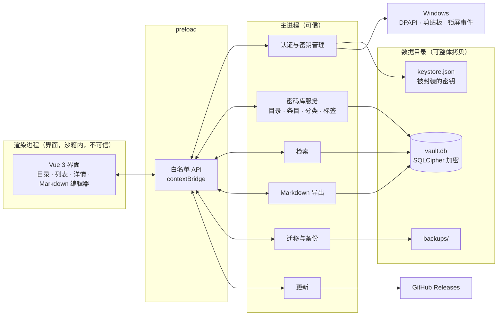

要点：

- **密钥和数据库只在主进程。** 界面进程拿不到主密钥，也不能直接读库，只能调用白名单接口。
- **密码类字段按需下发。** 列表和详情默认只返回遮蔽值；点“显示”才单独取一次明文；点“复制”由主进程直接写剪贴板，明文不经过界面。
- **唯一的网络访问是更新检查**（GitHub），可在设置里关闭。其余功能完全离线。

### 3.3 启动流程

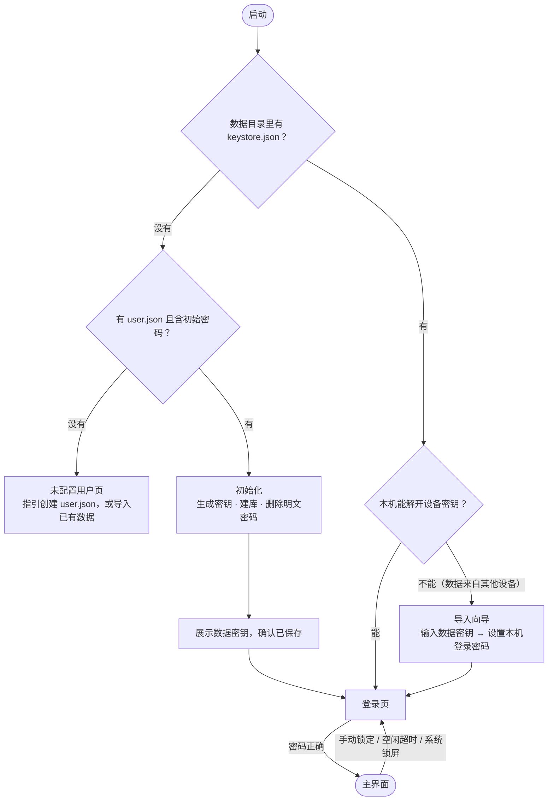

---

## 4. 功能设计

### 4.1 用户与登录

#### 4.1.1 用户只能通过文件配置（R-04）

- 软件是**单用户**的，界面里没有注册、新增用户、用户管理入口。
- 用户由数据目录下的 `user.json` 定义。首次使用时手工创建：

  ```json
  {
    "username": "wencong",
    "initialPassword": "在此填写初始登录密码"
  }
  ```

- 首次启动时程序读取该文件，用初始密码完成加密初始化，然后**立即把 `initialPassword` 从文件中删除**，文件只剩 `username`。密码本身不以任何形式保存，只保存由它派生并封装后的密钥（见 5.2）。
- 没有 `user.json` 时显示“未配置用户”页，给出文件位置、内容模板和“打开目录”“生成模板文件”“重新检测”按钮（示例图 02）。
- 初始密码少于 8 位时拒绝初始化并提示；建议 12 位以上。
- 初始化完成后再往 `user.json` 写 `initialPassword` 不起作用：没有旧密码或数据密钥解不开主密钥，所以改文件不能重置密码，程序会提示并忽略。

> 说明：初始密码会短暂以明文存在于文件中。程序会覆盖并重写该文件，但固态硬盘无法保证旧内容被物理擦除，因此建议首次登录后在“设置 › 安全”里改一次密码。如果你不接受明文落盘，替代方案见第 8 章第 3 项。

#### 4.1.2 登录与锁定（R-03、S-01）

- 登录页显示用户名（只读），只需输入登录密码（示例图 01）。
- 密码错误时提示并清空输入。连续错 5 次后延时 30 秒才能再试，之后每错一次延时翻倍，上限 15 分钟。这只是界面层的减速；真正抵抗暴力破解的是 5.2 节的密钥派生和设备绑定。
- 以下情况自动锁定，锁定时关闭数据库并清除内存中的密钥：
  - 手动点击“锁定”或按 `Ctrl+L`
  - 空闲超过设定时间（默认 5 分钟，可选 1 / 5 / 15 / 30 分钟 / 从不）
  - Windows 锁屏、休眠、睡眠
  - 最小化到托盘（可选，默认关）
- 编辑中的内容在锁定前自动保存为草稿，解锁后恢复。

#### 4.1.3 修改密码与忘记密码

- **修改密码**：设置 › 安全，输入当前密码和新密码。只重新封装主密钥，数据库不用重新加密，瞬间完成。
- **忘记密码**：登录页点“使用数据密钥恢复”，输入数据密钥后重新设置登录密码。
- 登录密码和数据密钥**同时丢失则数据无法恢复**，这是加密设计的必然结果，没有后门。

### 4.2 信息组织：目录、分类、标签（R-07、R-09）

三个维度各管一件事，互不混淆：

| 维度 | 回答的问题 | 形态 | 一个条目可以有几个 |
| --- | --- | --- | --- |
| **目录** | 它放在哪 | 级联树，层级不限（建议不超过 5 层） | 恰好 1 个 |
| **分类** | 它是什么东西 | 固定的几种类型，决定图标、颜色和默认字段 | 恰好 1 个 |
| **标签** | 它还跟什么有关 | 自由文本，跨目录横向归集 | 0 到多个 |

目录操作：

- 新建、重命名、删除、移动（右键“移动到…”为 P0；拖拽为 P1）。
- 同一父目录下不允许重名。
- 删除非空目录需二次确认，其中的条目全部进回收站，恢复时回到原目录（原目录已不存在则回到根目录）。
- 左侧栏点击目录，列表显示该目录**及其所有子目录**下的条目；点击分类或标签则跨目录筛选。

### 4.3 条目与字段（R-05）

条目统一为一种结构：**标题 + 分类 + 所在目录 + 若干字段 + 标签 + 备注（Markdown）**。分类只决定新建时预置哪些字段，之后字段可自由增删、改名、排序。

字段有四种类型：

| 字段类型 | 展示方式 | 是否参与检索 |
| --- | --- | --- |
| 文本 | 明文，一键复制 | 是 |
| 密码 | 默认 `••••••` 遮蔽；可临时显示、一键复制；复制后定时清剪贴板 | **否** |
| 网址 | 明文，可点击用系统浏览器打开 | 是 |
| 多行文本 | 等宽字体多行显示（适合密钥、证书、配置片段） | 是 |

内置分类及默认字段：

| 分类 | 默认字段 | 典型用途 |
| --- | --- | --- |
| 账号密码 | 用户名、密码、登录地址、绑定手机 / 邮箱 | 网站、OA、邮箱、VPN 账号 |
| 服务地址 | 地址（URL 或 IP:端口）、所属环境、用户名、密码 | 控制台、管理后台、接口地址 |
| 运维环境 | 主机地址、端口、用户名、密码、系统 / 版本、所属环境 | 服务器、数据库、中间件 |
| Markdown 文档 | 无字段，只有正文 | 部署手册、排障记录 |

其他行为：

- **收藏**与**最近使用**：侧栏顶部快捷入口。
- **回收站**（S-04）：删除先进回收站，30 天后自动清理，可手动恢复或彻底删除。
- **密码生成器**（S-05）：编辑密码字段时可调出，设置长度和字符集，一键填入（示例图 05）。

### 4.4 Markdown 文档（R-10）

Markdown 出现在两个地方：独立的“Markdown 文档”条目，以及每个普通条目的“备注”。两处用同一套编辑器和渲染器。

- 三种视图：编辑 / 分屏 / 预览（示例图 06）。
- 支持 CommonMark + GFM 常用扩展：表格、任务列表、删除线、围栏代码块及语法高亮。
- 工具栏提供标题、加粗、斜体、列表、代码、链接、图片、表格；也可直接手写语法。
- 图片：粘贴或拖入的图片作为附件**存进加密库**，不在磁盘上留明文文件。单张上限 10 MB。
- 停止输入 1 秒后自动保存。
- 安全限制：渲染结果经过净化，禁止脚本和内嵌 HTML 事件；**不加载远程图片**（避免打开文档时向外网发请求）；外部链接点击后先确认，再用系统浏览器打开。

### 4.5 检索（R-08）

- 入口：顶部搜索框或 `Ctrl+K`，任意界面可用（示例图 07）。
- 范围：标题、非密码字段的字段名和值、标签、目录名、Markdown 正文。
- **密码类字段永不进入索引，也不参与检索。**
- 中英文均按“包含”匹配，不区分大小写；多个词用空格分隔，表示同时包含。
- 结果按“条目 / 文档内容”分组，命中处高亮，文档显示命中片段；可按分类过滤。
- 键盘操作：`↑↓` 选择，`Enter` 打开，`Ctrl+U` 复制用户名，`Ctrl+P` 复制密码，`Esc` 关闭。
- 性能目标：一万个条目内，输入后 100 毫秒内出结果。

### 4.6 Markdown 导出（R-11）

入口：条目详情页的“导出”、目录右键菜单、设置 › 数据与迁移（示例图 08）。

| 选项 | 可选值 | 默认 |
| --- | --- | --- |
| 导出范围 | 仅当前条目 / 当前目录及子目录 / 整个密码库 | 视入口而定 |
| 文件组织 | 每个条目一个 `.md` 并保留目录层级 / 合并为单个 `.md` | 每条目一个文件 |
| 密码类字段 | 用 `******` 遮蔽 / 明文导出 | **遮蔽** |
| 其他 | 写入 YAML Front Matter、包含图片附件、打包为 zip | 前两项开 |

- 选择“明文导出”必须再输入一次登录密码，并显示醒目警告。
- 导出结果**不加密**，对话框里明确提示。
- 文件名取条目标题，Windows 不允许的字符替换为下划线，重名自动加序号。
- 多文件导出时在根目录生成 `README.md` 作为索引。

单个条目的导出结果示例：

```markdown
---
title: SIT-MySQL 主库
category: 运维环境
path: 公司/研发环境/测试环境 SIT
tags: [数据库, 中间件]
updated: 2026-11-12T16:42:00+08:00
---

# SIT-MySQL 主库

| 字段 | 值 |
| --- | --- |
| 主机地址 | 10.20.30.11 |
| 端口 | 3306 |
| 用户名 | app_rw |
| 密码 | ****** |
| 数据库 | order_center |

## 备注

（条目备注的 Markdown 原文）
```

### 4.7 数据迁移（R-12）

**前提：所有需要迁移的内容都在数据目录这一个文件夹里。** 默认位置 `%APPDATA%\PwVault\data`，可在设置里查看、打开、更改位置。

迁移步骤（示例图 10、12）：

1. **原电脑**：退出 PwVault，把数据目录整体拷贝出来（U 盘、内网共享等任意方式）。
2. **新电脑**：安装 PwVault，首次启动选择“导入已有数据”，选中拷贝过来的文件夹。
3. 程序识别出这是其他设备的数据，要求输入**数据密钥**。
4. 校验通过后，设置这台电脑上的登录密码（可与原来相同），完成。

设计细节：

- **为什么必须有数据密钥。** 日常登录的密钥与本机 Windows 账户绑定（见 5.2），数据文件夹离开本机后，仅凭登录密码解不开。这正是“文件夹被拷走也打不开”的来源，也是迁移时需要数据密钥的原因。
- **数据密钥是什么。** 初始化时随机生成的 256 位密钥，显示为 11 组、每组 5 个字符（示例图 03），含校验位，抄错一个字符能当场发现。字符集不含容易混淆的 I、L、O、U。
- **什么时候能看到。** 初始化完成时强制展示一次，要求输入最后一组确认已保存；之后可在“设置 › 数据与迁移”里凭登录密码再次查看。
- **导入不改动源文件夹**，程序把它复制到本机数据目录后再操作；原电脑上的数据仍可继续使用。
- **导入时会做完整性校验**，数据库损坏或密钥不匹配时明确报错，不产生半成品。
- **重新生成数据密钥**：设置里可以作废旧密钥、生成新密钥。注意：此前拷贝出去的旧数据文件夹仍然可以用旧密钥打开。
- 重装系统、更换 Windows 账户与换电脑等价，同样走导入流程。

各种意外情况下能否恢复：

| 情况 | 能否恢复 | 做法 |
| --- | --- | --- |
| 忘记登录密码，有数据密钥 | 能 | 登录页“使用数据密钥恢复” |
| 换电脑或重装系统，有数据密钥 | 能 | 导入向导 |
| 没记数据密钥，但原电脑还能登录 | 能 | 原电脑“设置 › 数据与迁移 › 查看数据密钥” |
| 换电脑或重装系统，没有数据密钥，原环境已不可用 | **不能** | — |
| 登录密码和数据密钥都丢了 | **不能** | — |

### 4.8 备份与恢复（S-03）

- 自动备份时机：每天第一次解锁后；每次升级安装前；每次数据格式升级前。
- 备份存放在数据目录的 `backups/` 下，**同样是加密的**，随数据目录一起迁移。默认保留最近 10 份。
- 每份备份包含数据库和密钥文件两部分。密钥文件一旦丢失或损坏，登录密码和数据密钥都将无法使用，所以它与数据库一起备份，并且每次改写都先写临时文件再原子替换。
- “从备份恢复”会先把当前数据另存一份再覆盖，恢复操作本身可撤销。
- 主密钥终身不变，改密码、换数据密钥都只是重新封装，所以任何历史备份都能用当前密码打开。

### 4.9 版本更新（R-13、R-14、R-15）

| 方式 | v1.0 | 适用场景 |
| --- | --- | --- |
| GitHub 在线更新 | 实现 | 办公电脑能访问 GitHub |
| 手动更新 | 实现 | 不能联网，或 GitHub 访问不稳定 |
| 内网 Nginx 更新 | 预留接口，不实现 | 后续版本 |

#### 4.9.1 GitHub 在线更新

1. 启动时（可关）或在“设置 › 更新”手动点击“检查更新”，向 GitHub Releases 查询最新版本。超时 10 秒；自动检查失败时不打扰，手动检查失败时提示原因。
2. 发现新版本时显示版本号、发布日期、大小和更新说明（示例图 11）。**不会自动下载**，由你点击“下载”。
3. 下载带进度，可取消。下载完成后校验安装包的 SHA-512。
4. 校验通过后自动备份数据，然后提示“重启并安装”。
5. 新版本首次启动时，如数据格式有变化则自动升级（之前已备份）。

#### 4.9.2 手动更新

两种做法，效果相同：

- **直接运行新安装包。** 从 GitHub 发布页或其他途径拿到 `PwVault-Setup-x.y.z.exe`，退出程序后运行，覆盖安装。
- **应用内选择安装包。** “设置 › 更新 › 选择安装包…”，程序检查版本号高于当前版本、显示文件的 SHA-256 供你与发布说明核对，然后自动备份、退出并启动安装。

无论哪种方式，安装程序只替换程序文件，**不触碰数据目录**；卸载默认也保留数据。

#### 4.9.3 内网 Nginx 更新（预留）

更新模块按“更新源”抽象，GitHub 是其中一种实现。后续增加内网源只需要在设置里填服务器地址，并把同样的发布文件放到 Nginx 静态目录下，不需要改动更新流程。界面上已预留该选项并标注“后续版本提供”。

#### 4.9.4 免安装版（v1.1）的差异

- 数据目录固定为 exe 同级的 `data\`。
- **不支持自动更新**（打包工具的限制），只做“检查到新版本 → 打开下载页”，由你手工替换 exe。
- 放在 U 盘里换电脑运行时，每台新电脑第一次都要输入数据密钥。是否为免安装版提供“关闭设备绑定”的选项，留到 v1.1 设计时决定。

#### 4.9.5 版本兼容规则

- 新版本程序可以打开旧版本数据，并自动升级数据格式。
- 旧版本程序遇到更新的数据格式会拒绝打开并提示升级程序，不会尝试写入。
- 需要回退版本时：重装旧版本安装包，再用“从备份恢复”选择升级前的那份备份。

### 4.10 设置项一览

| 分组 | 设置项 | 默认值 |
| --- | --- | --- |
| 通用 | 主题（浅色 / 深色 / 跟随系统，P2） | 浅色 |
| 通用 | 关闭窗口时：退出 / 最小化到托盘 | 退出 |
| 安全 | 修改登录密码 | — |
| 安全 | 空闲自动锁定时间 | 5 分钟 |
| 安全 | 系统锁屏或休眠时锁定 | 开 |
| 安全 | 最小化到托盘时锁定 | 关 |
| 安全 | 剪贴板自动清除时间 | 30 秒 |
| 安全 | 禁止截屏与屏幕共享 | 开 |
| 安全 | 默认隐藏密码字段 | 开 |
| 数据与迁移 | 数据目录位置、打开目录 | `%APPDATA%\PwVault\data` |
| 数据与迁移 | 查看 / 重新生成数据密钥 | — |
| 数据与迁移 | 自动备份开关、保留份数、立即备份、从备份恢复 | 开，10 份 |
| 数据与迁移 | 导入数据文件夹、导出 Markdown | — |
| 更新 | 启动时检查更新 | 开 |
| 更新 | 更新来源、网络代理 | GitHub，跟随系统 |
| 更新 | 选择安装包手动更新 | — |

安全类设置保存在加密库内，未解锁时无法被篡改；窗口大小、数据目录位置等设备相关设置保存在数据目录之外，不随迁移带走。

---

## 5. 安全设计（R-06）

### 5.1 防什么，不防什么

| 场景 | 是否防护 | 手段 |
| --- | --- | --- |
| 数据文件夹被拷走（U 盘、备份、误传网盘） | 防 | 全库加密；离开本机后必须有 256 位数据密钥，登录密码强度不够也无法被暴力破解 |
| 电脑被他人使用，程序处于锁定状态 | 防 | 必须输入登录密码；密钥派生刻意放慢，抗暴力尝试 |
| 离开座位忘记锁屏 | 缓解 | 空闲自动锁定、系统锁屏联动 |
| 开会共享屏幕、截图时泄露 | 缓解 | 禁止窗口被捕获；密码默认遮蔽 |
| 密码残留在剪贴板 | 缓解 | 定时清除 |
| 更新包被替换 | 缓解 | HTTPS 下载 + SHA-512 校验（代码签名见第 8 章） |
| Markdown 内容里夹带脚本 | 防 | 渲染净化、内容安全策略、禁远程资源 |
| 本机已中木马、键盘记录器，或攻击者有管理员权限 | **不防** | 超出本工具能力范围，任何本地密码管理器都无法防护 |
| 解锁状态下的内存取证 | **不防** | 仅做到锁定时尽力清除 |

### 5.2 密钥体系

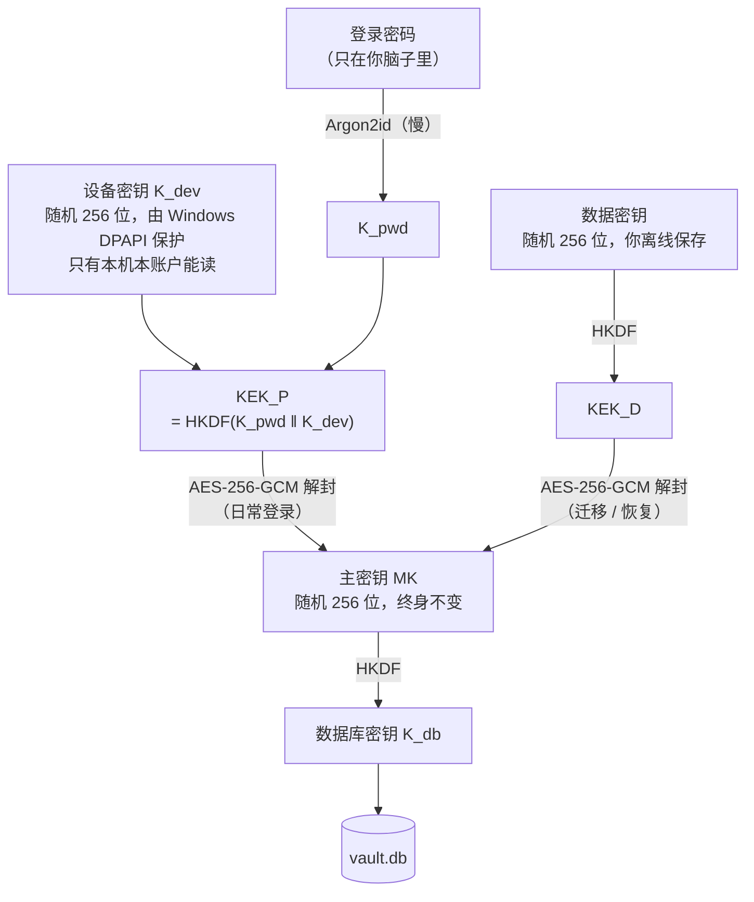

| 名称 | 来源 | 存在哪里 | 作用 |
| --- | --- | --- | --- |
| 登录密码 | 你设定 | 不保存 | 日常解锁 |
| 设备密钥 K_dev | 初始化或导入时随机生成 | `keystore.json`，经 DPAPI 加密 | 把日常解锁绑定到本机本账户 |
| 数据密钥 | 初始化时随机生成 | 你离线保存；加密库内另存一份供再次查看 | 迁移与恢复 |
| 主密钥 MK | 初始化时随机生成 | `keystore.json`，被封装两次（两个“槽”） | 一切数据加密的根 |
| 数据库密钥 K_db | 由 MK 派生 | 只在内存 | 加密 `vault.db` |

这套结构带来的性质：

- **日常登录 = 登录密码 + 本机。** 两者缺一不可，所以数据文件夹被拷走后，对方即使知道登录密码也打不开。
- **迁移与恢复 = 数据密钥。** 数据密钥是真随机的 256 位，不可能被猜出来。
- **改密码、换数据密钥都不用重新加密数据**，只改写 `keystore.json` 中对应的槽。
- 判断密码对不对不需要额外保存校验值：密码错则解封失败。

### 5.3 关键流程

**初始化**（首次启动，读到 `user.json` 里的初始密码）：

1. 生成主密钥 MK、设备密钥 K_dev、数据密钥，各 256 位随机数。
2. 用“登录密码 + K_dev”封装 MK，写入密码槽；用数据密钥封装 MK，写入数据密钥槽。
3. 用 K_db 创建加密数据库，写入内置分类。
4. 从 `user.json` 删除初始密码。
5. 展示数据密钥，确认已保存后进入登录页。

**登录**：用 DPAPI 取出 K_dev → 由输入的密码派生 K_pwd → 合成 KEK_P → 解封 MK → 派生 K_db → 打开数据库。任何一步失败都按“密码错误”处理。

**导入 / 恢复**：输入数据密钥 → 解封 MK → 能打开数据库即校验通过 → 生成本机新的 K_dev → 用新设的登录密码重建密码槽。

**锁定**：关闭数据库 → 把内存中的 MK、K_db 等缓冲区清零 → 回到登录页。

### 5.4 存储加密

- `vault.db` 用 SQLCipher 整库加密（AES-256，逐页带完整性校验）。条目、字段、Markdown 正文、图片附件、检索索引、目录结构**全部在加密库内**，磁盘上没有任何明文数据。
- `keystore.json` 是明文 JSON，但里面只有盐值、算法参数和被封装的密钥，单独拿到它没有用。
- 密钥派生采用 Argon2id，内存 64 MiB、迭代 3 次、并行度 4，目标是在你的电脑上耗时约 0.5–1 秒。参数记录在 `keystore.json` 里，将来可以调高。
- 所有随机数来自操作系统的密码学随机源。

### 5.5 运行时防护

- 密码类字段默认遮蔽，离开页面自动恢复遮蔽。
- 复制由主进程完成；到时间后，只有当剪贴板内容仍是当初复制的那段时才清除，不误伤你之后复制的其他内容。
- 窗口默认禁止被截屏和屏幕共享捕获（S-06）。
- 日志不记录任何字段值、密码、密钥，只记录操作类型和错误信息。
- 单实例运行，避免两个进程同时写数据库。

> 局限：Windows 的“剪贴板历史记录”（Win+V）和云剪贴板可能留存复制过的内容。程序会尝试标记“不进入历史记录”，但该能力需要在技术验证阶段确认；不确定能否做到时，文档中会建议关闭系统的剪贴板历史。

### 5.6 应用加固

- 界面进程开启沙箱与上下文隔离，不能访问 Node 能力和文件系统。
- 界面只加载安装包内的本地页面，禁止跳转到任何外部地址，禁止新开窗口。
- 内容安全策略只允许本地脚本和样式。
- 所有接口入参在主进程做类型和范围校验。
- 正式版禁用开发者工具。
- 拒绝所有权限请求（摄像头、定位、通知等）。

### 5.7 更新安全

- 版本信息和安装包全程走 HTTPS。
- 下载完成后校验 SHA-512，不匹配则丢弃。
- 不允许降级安装到更低版本。
- v1.0 不做代码签名（需要购买证书），因此首次运行安装包时 Windows 会弹出 SmartScreen 提示，需要手动点“仍要运行”。是否购买证书见第 8 章。

---

## 6. 数据设计

### 6.1 目录布局

```text
%APPDATA%\PwVault\
├─ data\                      ← 数据目录：迁移时拷贝这一个文件夹
│  ├─ user.json               用户名（初始化后不含密码）
│  ├─ keystore.json           被封装的密钥、算法参数
│  ├─ vault.db                加密数据库（唯一的数据文件）
│  └─ backups\
│     ├─ vault-20261116-090312.db
│     └─ keystore-20261116-090312.json
├─ settings.json              设备相关设置：窗口大小、数据目录位置、更新选项
└─ logs\                      运行日志（不含敏感内容）
```

数据库采用单文件模式，程序退出或锁定后目录里不会留下临时文件，所以“退出后拷贝文件夹”得到的一定是完整一致的数据。

### 6.2 keystore.json 结构

```json
{
  "format": 1,
  "vaultId": "b3f1c2d4-…",
  "createdAt": "2026-03-02T09:15:00+08:00",
  "slots": {
    "password": {
      "kdf": { "alg": "argon2id", "memoryKiB": 65536, "iterations": 3, "parallelism": 4, "salt": "…" },
      "deviceSecret": "…（DPAPI 加密后的 K_dev）",
      "wrap": { "alg": "AES-256-GCM", "nonce": "…", "ciphertext": "…" }
    },
    "dataKey": {
      "kdf": { "alg": "HKDF-SHA256", "salt": "…" },
      "wrap": { "alg": "AES-256-GCM", "nonce": "…", "ciphertext": "…" }
    }
  }
}
```

`vaultId`、格式版本和算法参数参与封装时的完整性校验，被改动会导致解封失败，不能通过改文件来降低安全强度。

### 6.3 逻辑数据模型

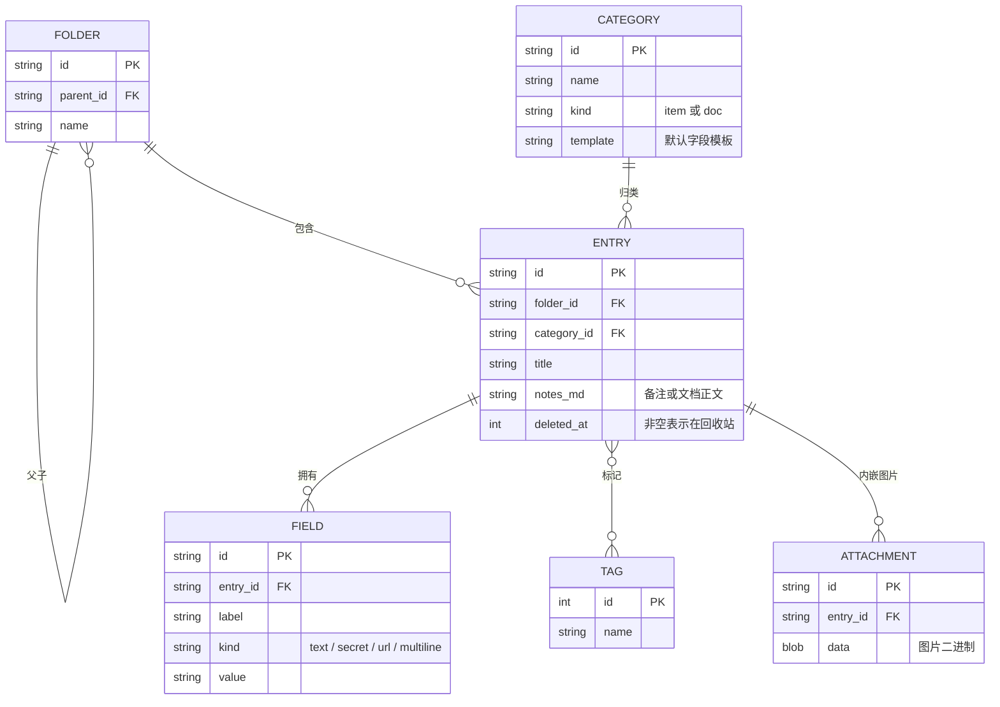

完整建表语句见《开发文档》第 7 章。

---

## 7. 界面设计（R-16）

### 7.1 原则

1. **一个窗口，三栏到底。** 左边选范围，中间选条目，右边看内容。没有多窗口，没有多级菜单。
2. **常用动作不超过两步。** 找到条目后，复制任何字段都是一次点击或一个快捷键。
3. **敏感信息默认不可见。** 密码遮蔽，明文需要主动点击。
4. **状态说人话。** “已复制密码，30 秒后自动清除剪贴板”，而不是“操作成功”。
5. **危险操作讲清后果。** 导出不加密、数据密钥丢失不可恢复，都在操作当场写明。

窗口默认 1280 × 800，最小 1000 × 640。界面语言为简体中文。

### 7.2 总览

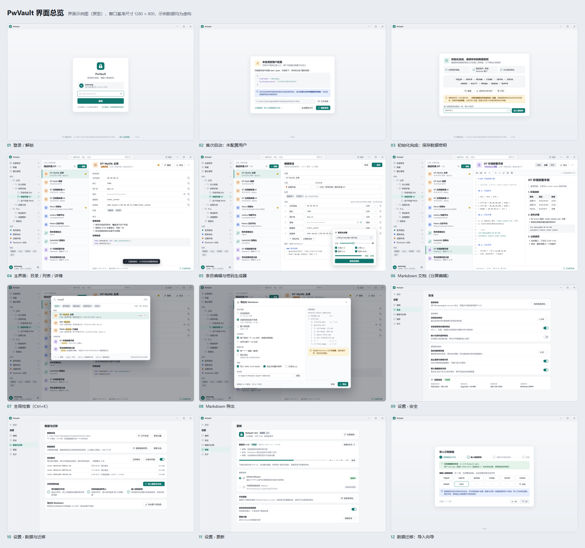

### 7.3 各界面说明

#### 01 登录 / 解锁

只显示用户名和一个密码框。底部给出数据目录位置和“导入已有数据”入口。

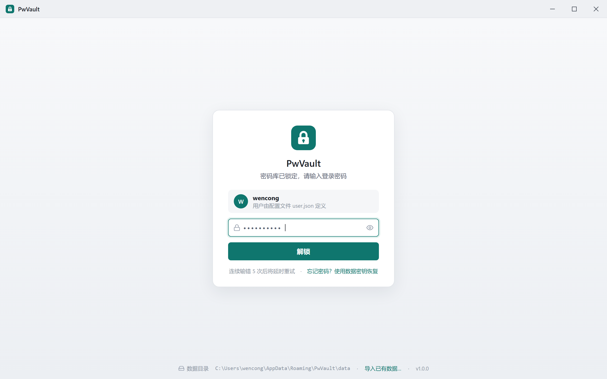

#### 02 首次启动：未配置用户

对应“用户只能通过文件配置”。页面直接给出文件位置和内容模板，不提供任何在界面里创建用户的途径。

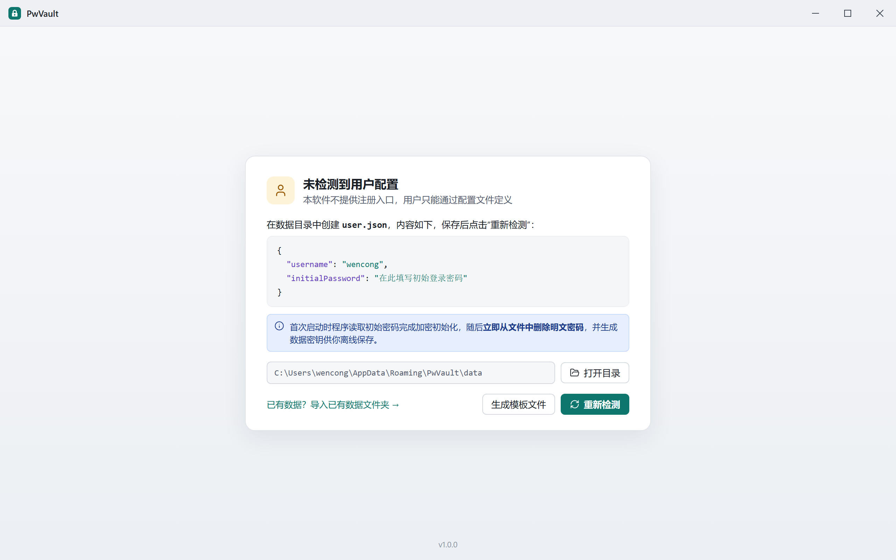

#### 03 初始化完成：保存数据密钥

强制展示一次，输入最后一组确认已保存后才能继续。

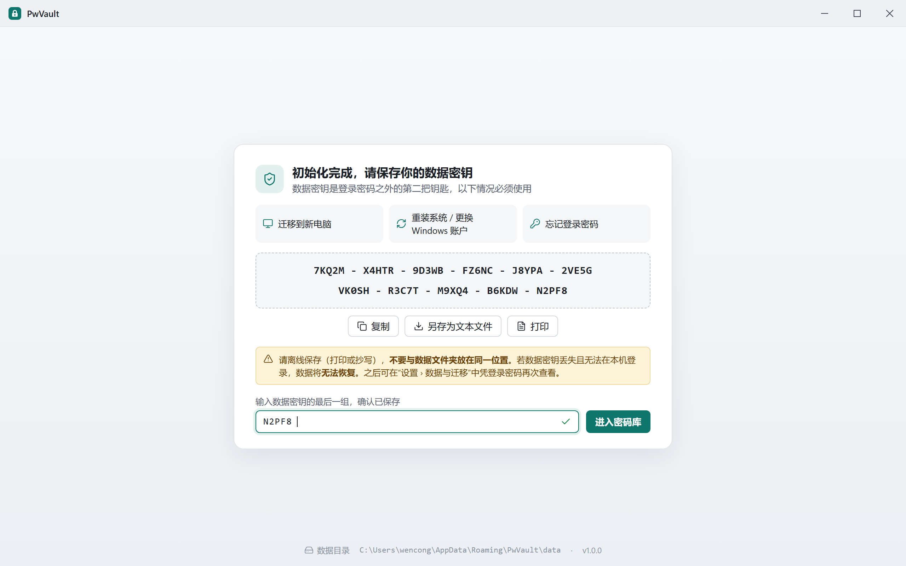

#### 04 主界面

- **左栏**：快捷入口（全部、收藏、最近使用）、级联目录树、分类、标签；底部是用户与锁定状态。
- **中栏**：当前范围下的条目列表，图标颜色区分分类。
- **右栏**：条目详情。每个字段右侧是复制按钮，密码字段多一个显示按钮；下方是渲染后的 Markdown 备注。

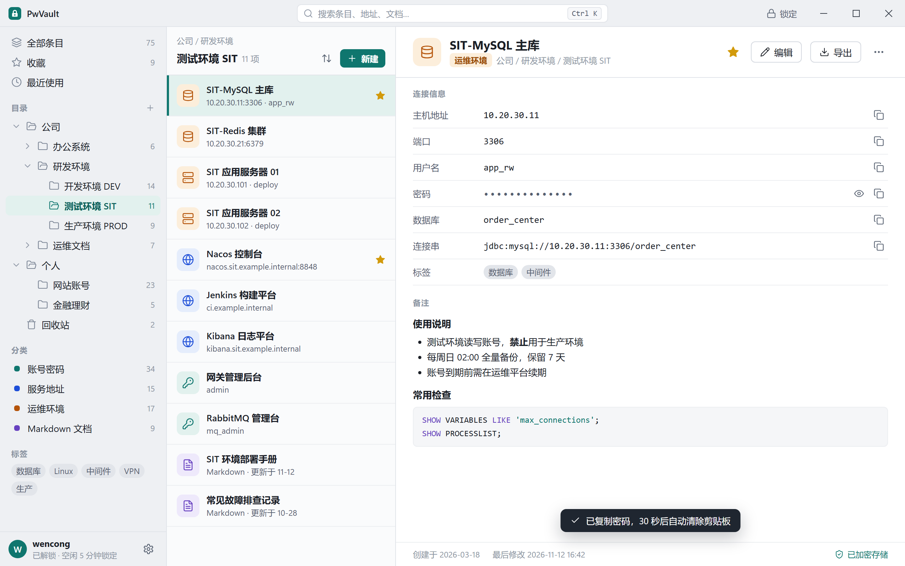

#### 05 条目编辑与密码生成器

字段可增删、改名、改类型、拖动排序。密码字段右侧的闪电图标调出生成器。

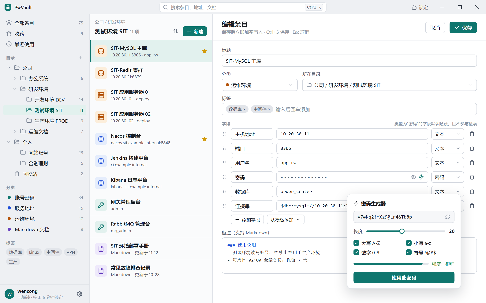

#### 06 Markdown 文档

分屏视图：左侧源码，右侧实时预览。右上角切换编辑 / 分屏 / 预览。

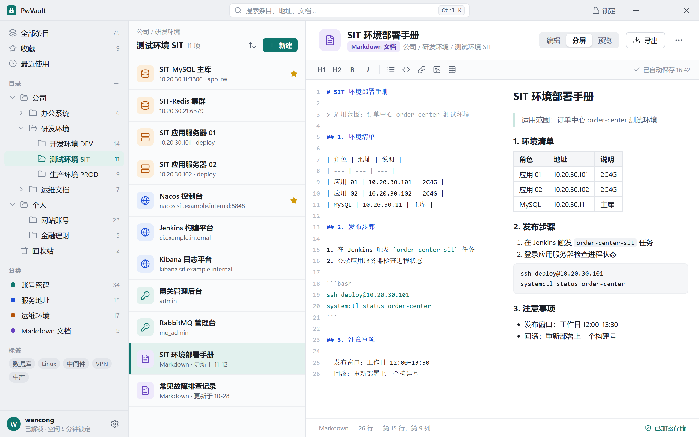

#### 07 全局检索

`Ctrl+K` 呼出。结果分“条目”和“文档内容”两组，命中处高亮，全程可只用键盘操作。

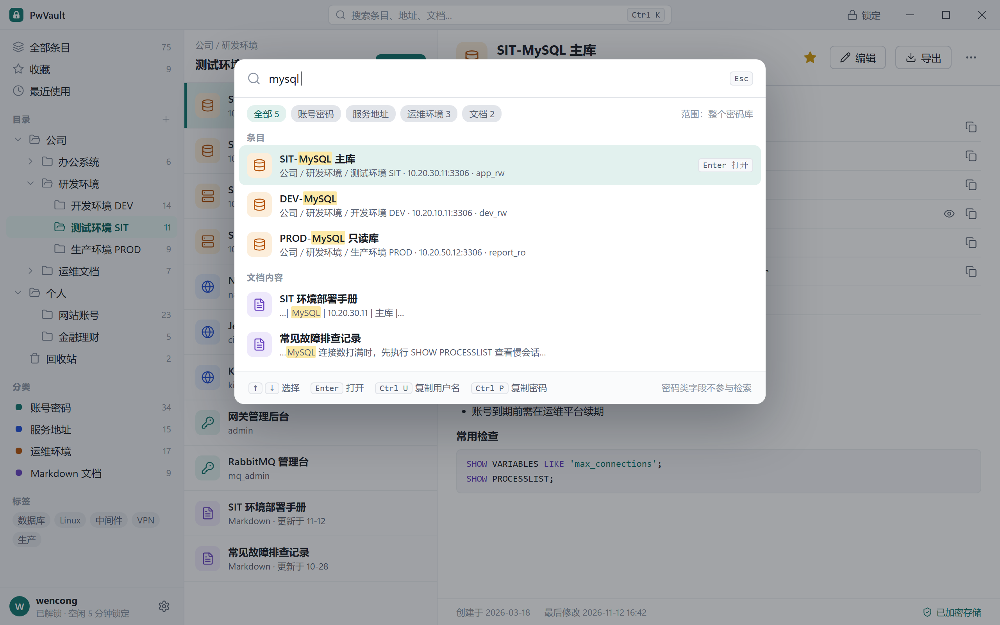

#### 08 Markdown 导出

左侧选项，右侧实时预览将要生成的文件结构，并提示导出结果不加密。

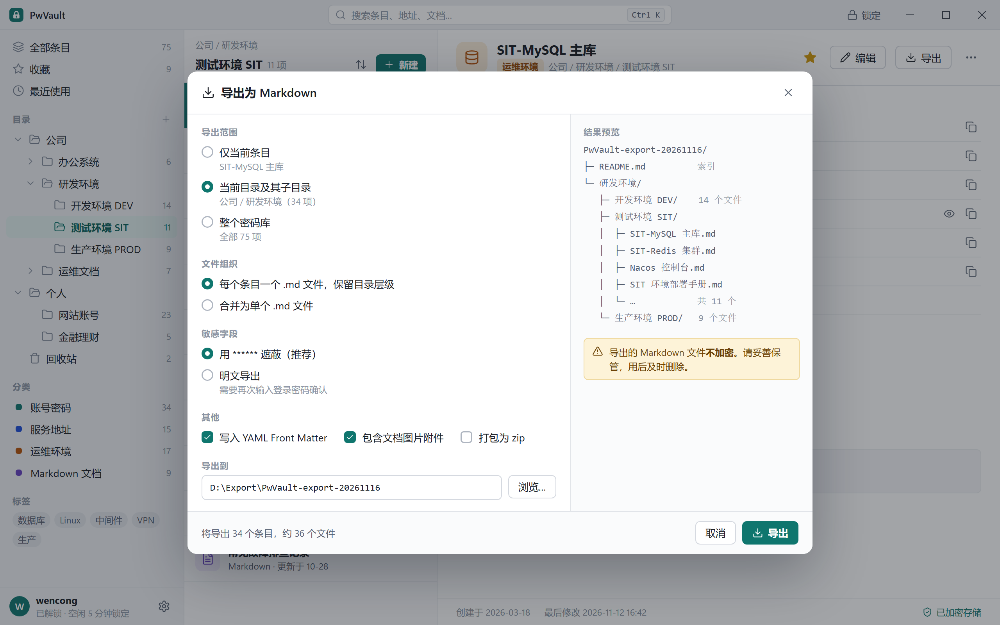

#### 09 设置 › 安全

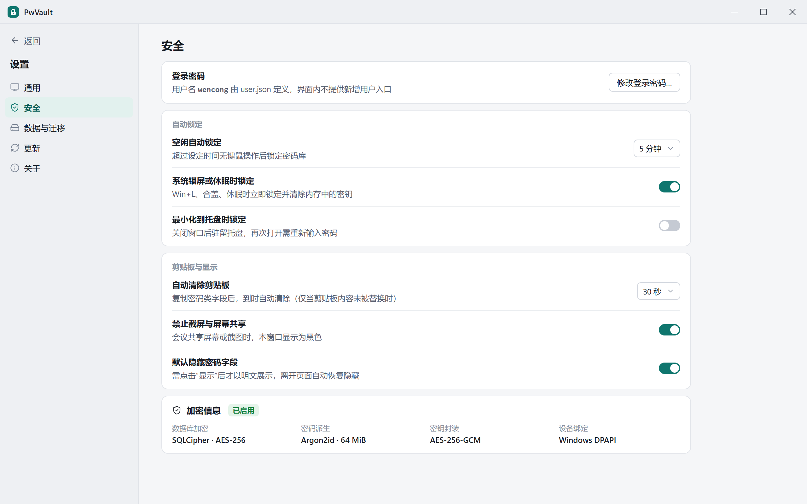

#### 10 设置 › 数据与迁移

数据目录、数据密钥、自动备份、迁移三步说明和导出入口集中在一页。

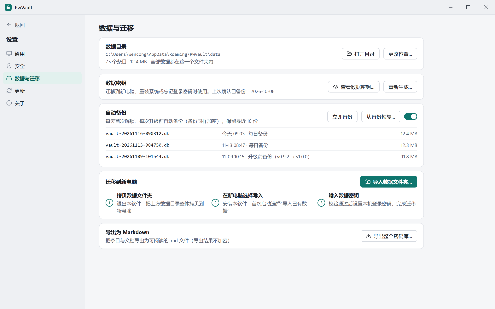

#### 11 设置 › 更新

当前版本、新版本说明与下载进度、更新来源（GitHub 使用中，内网服务器预留）、手动选择安装包。

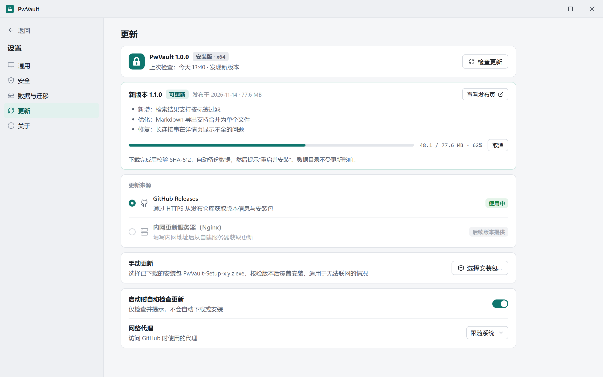

#### 12 数据迁移：导入向导

四步：选择数据文件夹 → 输入数据密钥 → 设置本机登录密码 → 完成。

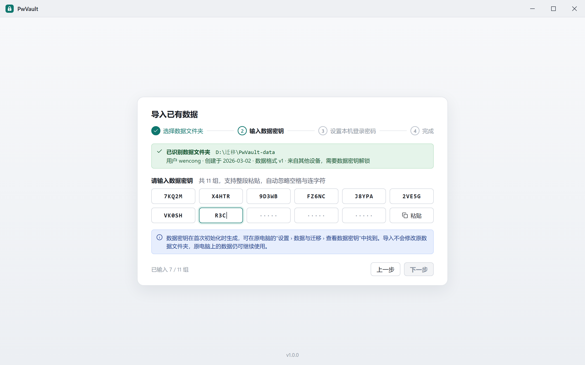

### 7.4 快捷键

| 快捷键 | 作用 |
| --- | --- |
| `Ctrl+K` | 全局检索 |
| `Ctrl+N` | 在当前目录新建条目 |
| `Ctrl+E` | 编辑当前条目 |
| `Ctrl+S` | 保存 |
| `Ctrl+U` / `Ctrl+P` | 复制当前条目的用户名 / 密码 |
| `Ctrl+L` | 立即锁定 |
| `Esc` | 关闭弹层 / 取消编辑 |

### 7.5 关于示例图

示例图是用 HTML 原型渲染出来的，用于确认布局、信息层级和文案，不是最终实现。图中的数据全部虚构。原型源文件在 `docs/ui/mockups/`，改动后运行 `node docs/ui/mockups/render.mjs` 即可重新生成全部图片。

---

## 8. 待确认事项

下面每一项我都给了推荐方案，文档其余部分按推荐方案写成。你不同意的地方告诉我，我改对应章节。

| # | 决定 | 推荐 | 备选及影响 |
| --- | --- | --- | --- |
| 1 | 技术栈 | Electron + TypeScript | Tauri 2：安装包小一个量级、内存低，但要先装 Rust 和 VS Build Tools，后端用 Rust 写 |
| 2 | 界面框架 | Vue 3 | React：对架构无影响，按你熟悉的选 |
| 3 | 用户配置文件的形式 | `user.json` 写初始明文密码，首次启动后程序删除 | 提供命令行 `PwVault.exe --init-user` 交互输入密码，明文不落盘，但多一步命令行操作 |
| 4 | 界面内是否允许修改登录密码 | 允许（这不属于“新增用户”） | 不允许：则改密码只能走“数据密钥恢复”流程 |
| 5 | 迁移时只凭数据密钥，还是数据密钥 + 原登录密码 | 只凭数据密钥，同时可用于忘记密码时恢复 | 两者都要：更严格，但忘记密码就彻底无法恢复 |
| 6 | 发布仓库是否公开 | 源码仓库私有，另建一个只放安装包的公开仓库 | 全私有：在线更新需要在程序里内置访问令牌，不推荐 |
| 7 | 是否购买代码签名证书 | v1.0 不买 | 购买：消除 SmartScreen 警告，更新时多一层发布者校验，每年有费用 |
| 8 | 产品名称与图标 | PwVault + 示例图中的锁形图标 | 你定 |

另外有两件事需要你去确认，我在这台电脑上验证不了：

- **办公电脑的终端安全策略是否允许运行未签名的自装程序。** 如果不允许，第 7 项就必须选“购买证书”，或者走公司的软件白名单流程。
- **办公网络能否稳定访问 GitHub**（包括下载发布包的域名）。不稳定的话日常以手动更新为主，在线更新作为补充。

---

## 9. 风险

| 风险 | 影响 | 应对 |
| --- | --- | --- |
| 数据密钥没有妥善保存 | 换电脑或重装系统后数据永久丢失 | 初始化时强制确认；设置页显示“上次确认已备份”的日期；迁移说明反复提示 |
| 重装系统、重建 Windows 账户导致设备密钥失效 | 登录密码打不开，需要数据密钥 | 与上一条相同；这是“文件夹被拷走也打不开”的代价 |
| 办公电脑拦截未签名程序 | 无法安装或更新 | 开发前先用空壳安装包在办公电脑上实测（开发文档 M0） |
| GitHub 访问不稳定 | 在线更新失败 | 检查更新有超时、失败不阻塞使用；手动更新始终可用 |
| 加密数据库组件与 Electron 版本不匹配 | 无法构建 | M0 阶段先验证；备选方案见开发文档 §15 |
| 用个人工具保存公司凭据是否合规 | 制度风险 | 建议先确认公司信息安全制度 |
